# FullTime Local

A small self-hosted app for running tournaments with friends — brackets, tables,
scores, stats and ratings. Your app data stays local. Optional club lookups fetch
team details and crests from football-data.org.

Backend: FastAPI + SQLite. Frontend: React + Vite. Shipped as one Docker image.

---

## Features

- **5 tournament formats** — round-robin (single or home & away), knockout,
  group + finals, Swiss, and Champions League.
- **Random draws by default** — participants are shuffled so nobody gets a
  systematically easy or hard run of matches; manual seeding is still available.
- **Auto-scheduling** across a set number of pitches/TVs, giving players fair rest.
- **Results & standings** — enter scores, tables update, knockouts advance, with a
  bracket view and an automatic champion.
- **Friendlies** — record casual one-off matches alongside tournaments, optionally assign clubs to each side, and
  browse match history with filters and pagination. Player names link directly to their profiles.
- **Player profiles** — nickname + real name, plus separate tournament and
  friendly tabs with searchable, filterable and paginated histories.
- **Compare** any two players (head-to-head and side-by-side), or jump straight from a friendly to its players'
  comparison.
- **Form charts** — Elo, rating and cumulative goals over time on each player profile.
- **Automatic ratings** — an Elo for tournaments and one for friendlies.
- **Notes & themes** — tag a tournament with the game you played; choose from 4 themes in Settings.
- **TV mode** — a big-screen view that cycles standings, fixtures, brackets and results.
- **Optional club crests** — connect football-data.org in Settings and assign clubs to tournament participants or
  friendly sides;
  multiple players can share a club.
- **Settings** — theme, optional football data integration, account management, full backup and FullTime backup
  import.
- **Time estimate** — planned duration from match length + changeover; new events pre-fill
  from past ones. Admins can adjust actual duration while closing or afterward; corrections
  also feed timing calibration.
- **Locked results** — a completed tournament is read-only; reopen it to fix a score, then close it again.
- **Safe roster editing** — update participants on active tournaments; if scores exist, rebuilding fixtures requires explicit confirmation.
- **Login & roles** — open by default; set `FTL_PASSWORD` or create users to
  require login. Admins can do everything, viewers are read-only.

---

## Screenshots

_Screenshots use mock data._

| | |
|---|---|
| 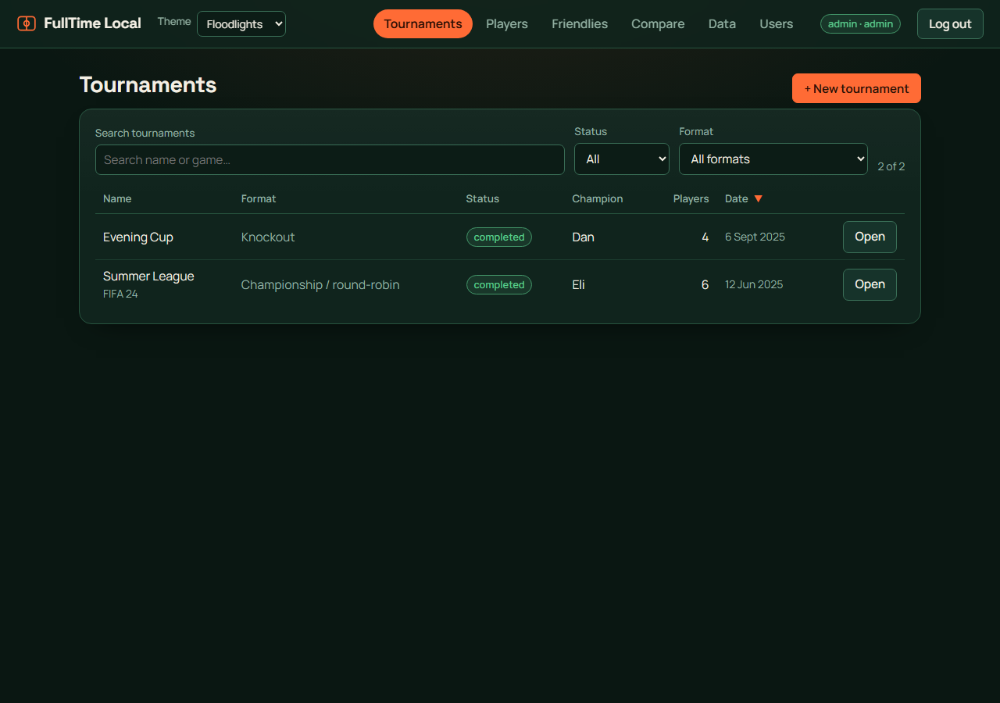 | 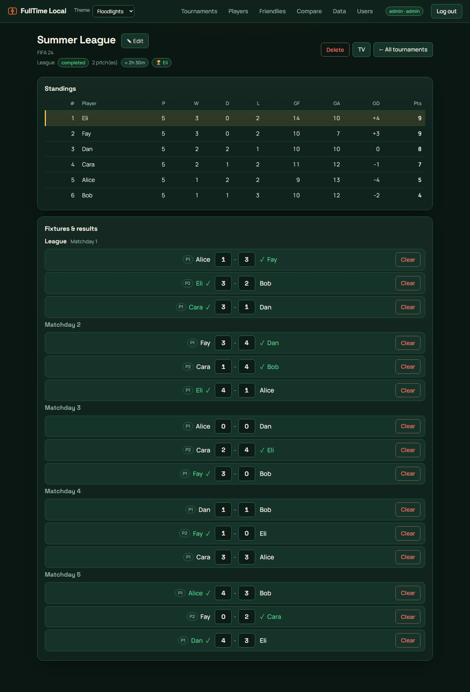 |
| Tournaments list | A league: standings + fixtures |
| 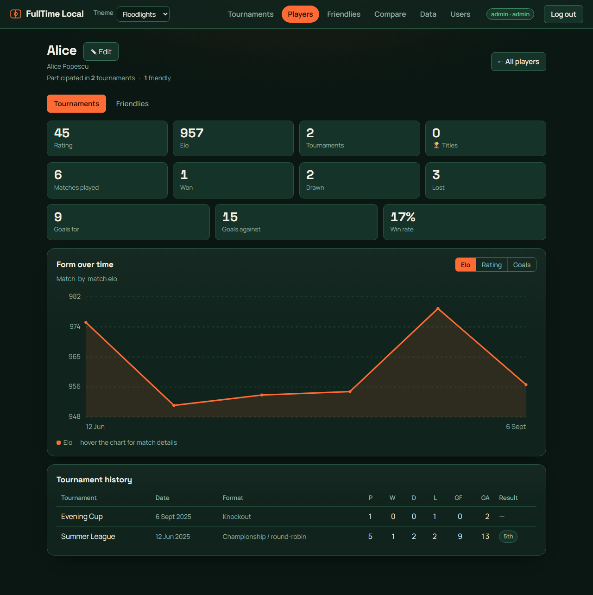 | 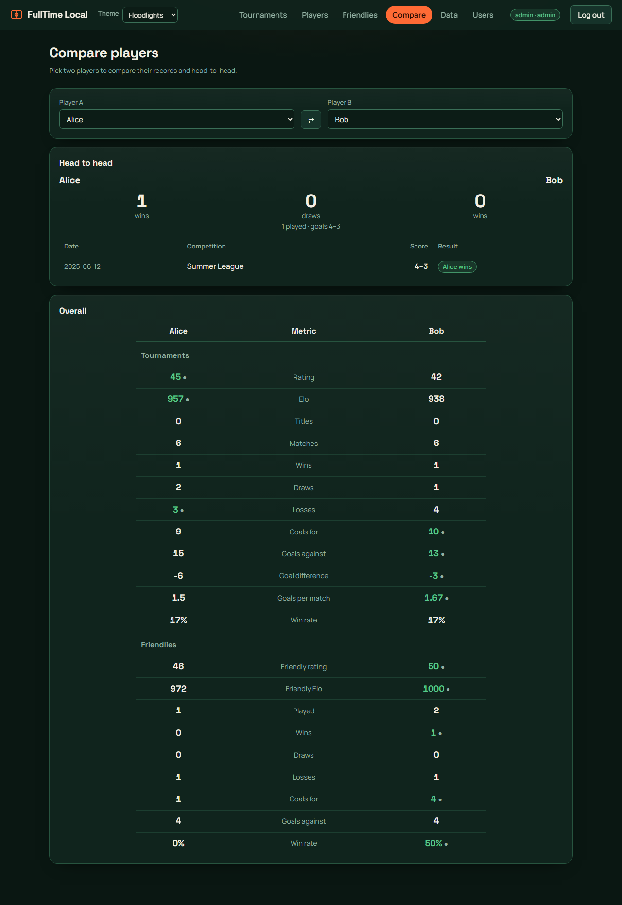 |
| Player profile (tournaments / friendlies tabs) | Compare two players |
| 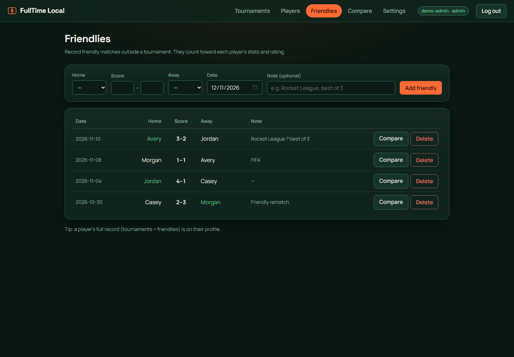 | 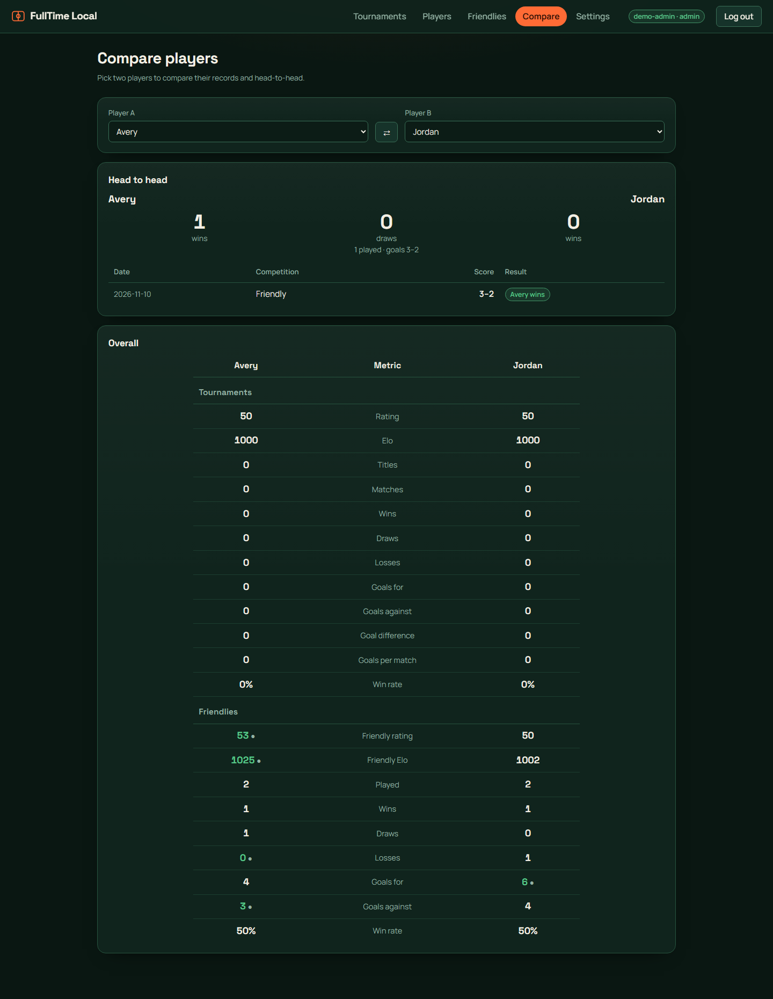 |
| Friendly rows have a direct Compare action | The two players are preselected in the comparison |
| 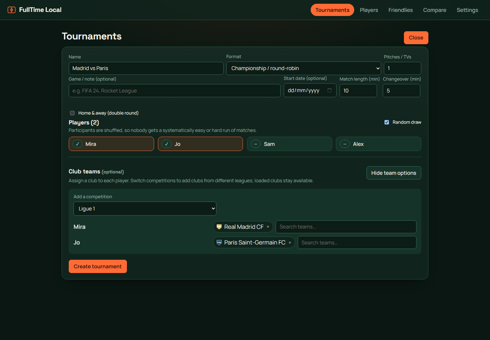 | 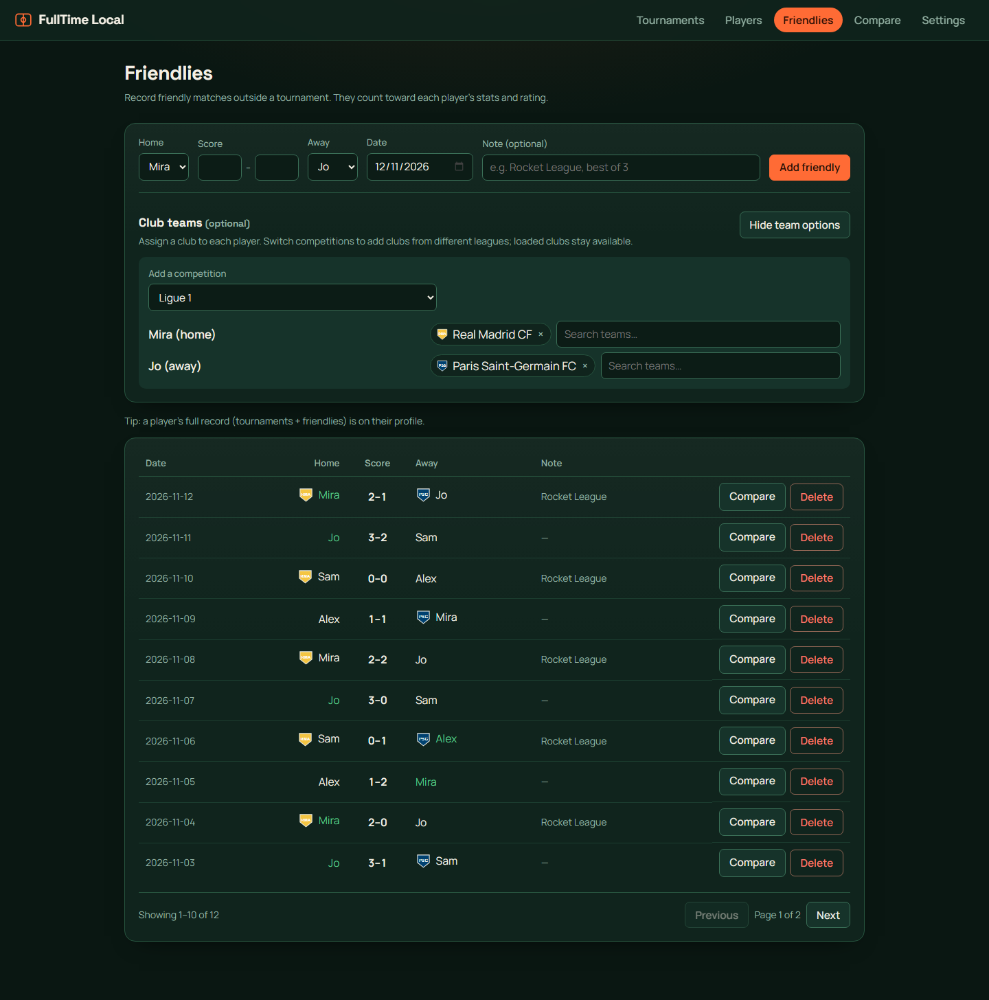 |
| Search across competitions when choosing a tournament club | Optional club badges on a friendly plus paginated match history |
| 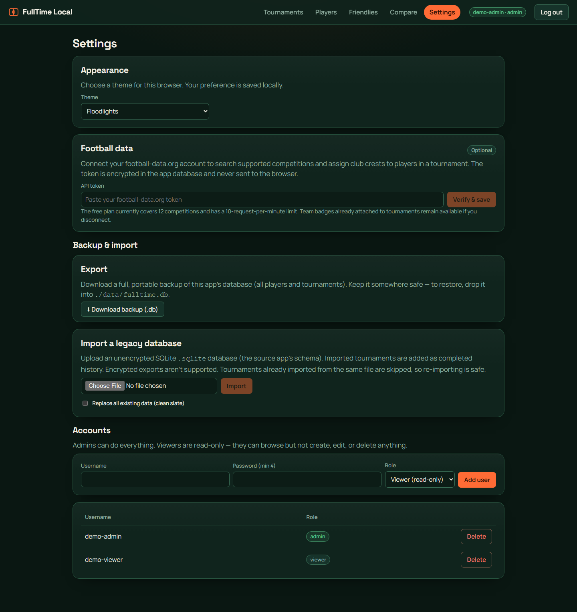 | 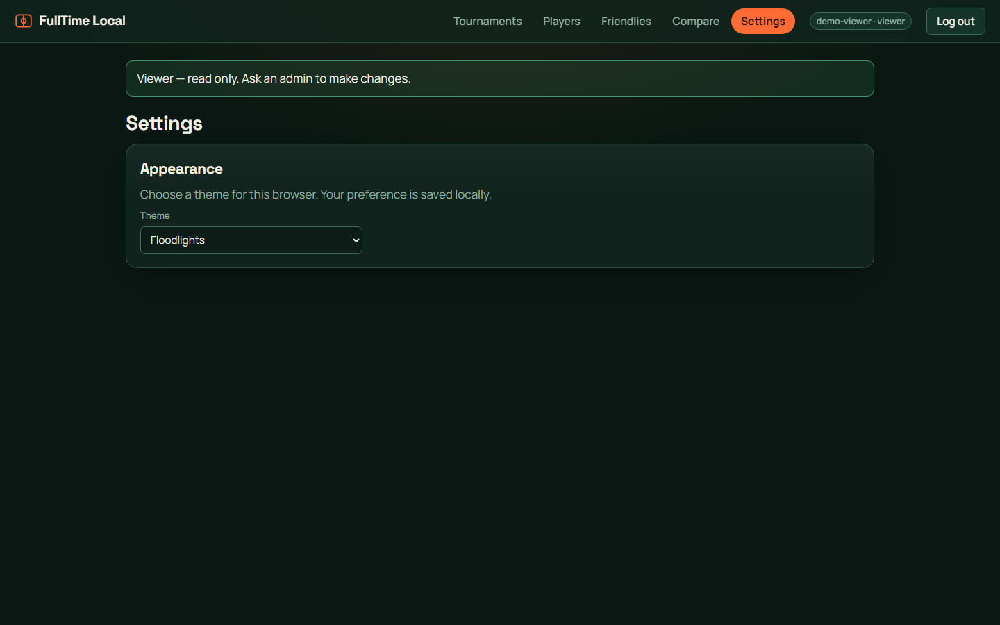 |
| Theme, football data, backup/import and accounts | Viewers see only the theme setting |
| 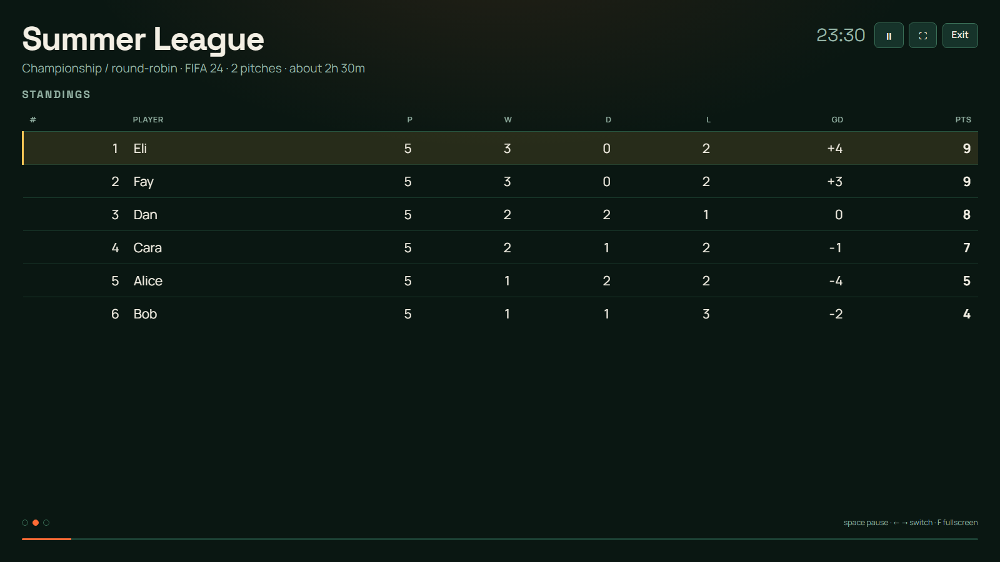 | |
| TV mode for the venue screen | |

### Settings and club badges

- The theme is a per-browser preference and is available to every account, including viewers.
- Admins can connect a football-data.org token under **Settings → Football data**. The token is encrypted in the
  local database and is never sent to the browser. Team lookup is hidden until a token is configured; competition
  and team data are requested only when the optional team picker is used.
- During tournament setup or while recording a friendly, load one or more supported competitions and optionally
  assign clubs to the players (for example, Real Madrid and PSG in the same tournament). Team search shows results
  only after typing; loaded clubs stay available when switching competitions. Club IDs, names and crest URLs are
  cached locally and shown in fixtures, friendlies, standings, brackets and TV mode; badge images load from provider
  URLs. Disconnecting the provider keeps existing assignments intact.
- **Settings → Backup & import** contains the full database backup and FullTime backup import.
  **Settings → Accounts** is admin-only.
- Viewers can browse the app but see only **Appearance** in Settings.

---

## Quick start (Docker)

The image is public on GHCR — no login needed. Use this `docker-compose.yml`:

```yaml
services:
  app:
    image: ghcr.io/catadoxy/fulltime-local:latest
    ports:
      - "8756:8756"
    volumes:
      - ./data:/data
    restart: unless-stopped
```

```bash
docker compose up -d        # then open http://localhost:8756
```

The SQLite database lives in `./data/fulltime.db` on the host.

### Build from source instead

```bash
git clone https://github.com/catadoxy/fulltime-local.git
cd fulltime-local
docker compose -f docker-compose.build.yml up --build
```

---

## Run for development

**Backend**
```bash
cd backend
python -m venv .venv && source .venv/bin/activate   # Windows: .venv\Scripts\activate
pip install -r requirements.txt
uvicorn app.main:app --reload --port 8756
```

**Frontend**
```bash
cd frontend
npm install
npm run dev        # http://localhost:5173 (proxies /api to :8756)
```

---

## Ratings

Ratings are calculated automatically — nothing to set by hand. Each player has
**two Elo ratings**, both starting at 1000:

- **Tournament Elo** — from tournament matches only (Players list + Tournaments tab).
- **Friendly Elo** — from friendlies only (Friendlies tab).

Per match: `expected = 1 / (1 + 10^((opponent − you) / 400))`, then
`you += K × margin × (actual − expected)`, where a win is 1, a draw 0.5, a loss 0,
`K` is larger for new players, and `margin` gives a small bonus for a bigger win.
Penalty shoot-outs count as draws.

The 0–100 figure shown is `round(50 + (elo − 1000) / 8)` (1000 → 50, 1200 → 75).

---

## Importing a FullTime Local backup

Download a `.db` backup from **Settings → Backup & import**, then upload it in the same section to merge its
players, tournaments, results, friendlies and club badges into the current installation. Players with matching names
are reused, duplicate tournaments and friendlies are skipped, and user accounts and API settings stay local to this
installation. Use **Replace tournament data** for a clean restore of those records; accounts and settings are
preserved. A pre-import preview shows the records to add, reuse and skip. To restore the complete database including
accounts, stop the app and replace `./data/fulltime.db` with the backup file.

---

## Configuration

All optional, via environment variables:

| Variable           | Default                            | Purpose                          |
| ------------------ | ---------------------------------- | -------------------------------- |
| `FTL_DATA_DIR`     | `backend/data`                     | folder holding the SQLite DB     |
| `FTL_DATABASE_URL` | `sqlite:///<DATA_DIR>/fulltime.db` | full database URL override       |
| `FTL_FRONTEND_DIR` | `frontend/dist`                    | where the built SPA is served    |
| `FTL_PASSWORD`     | *(unset)*                          | legacy single admin password (login as `admin`). Prefer user accounts. |
| `FTL_SECRET`       | auto (file in data dir)            | session-cookie signing key       |

### Users & roles

Open the app with no users and no `FTL_PASSWORD` and everything is editable
(previous behaviour). To secure it, either:

- set `FTL_PASSWORD` (legacy: log in as `admin` with that password), or
- open the app and create the first admin account in the setup screen.

Admins manage named accounts under **Settings → Accounts**: `viewer` accounts are read-only (they can browse but
every `POST`/`PATCH`/`DELETE` returns `403`) and see only the theme in Settings; `admin` accounts can do everything.
The last admin cannot be deleted or demoted.

---

## Releases

Every push to `main` publishes `ghcr.io/catadoxy/fulltime-local:latest`. A version
tag publishes semver images (e.g. `:0.3.0`) **and** creates a GitHub Release:

```bash
git tag v0.3.0 && git push origin v0.3.0
```

Pin a version in production by using e.g. `ghcr.io/catadoxy/fulltime-local:0.3.0`.

---

## Development notes

- Tests: `cd backend && python -m pytest -q`
- Layout: `backend/app` (FastAPI — routers, models, `engine/` algorithms,
  `services/`) and `frontend/src` (React pages + typed API client).
- `Dockerfile` is a multi-stage build (Node build → Python runtime).

---

## License

[MIT](LICENSE)
